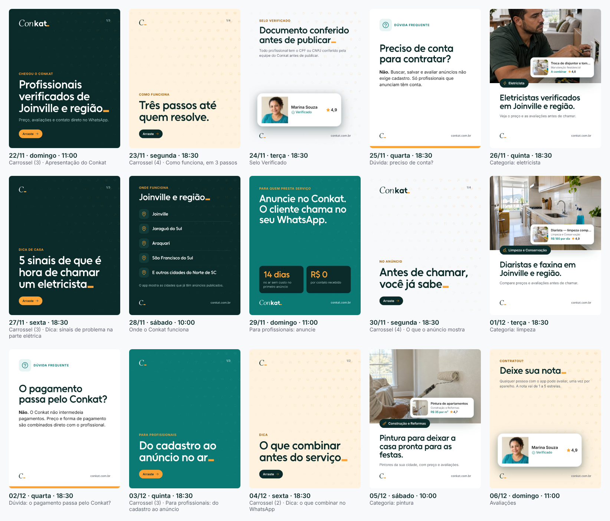

# Instagram — próximos 15 dias

Gerado por `node brand/gerar-calendario.mjs --inicio 2026-11-22 --dias 15`. A pauta fica em
[`../calendario.mjs`](../calendario.mjs): mude lá e rode o script de novo (esta pasta é apagada e refeita).

Cada pasta tem os slides (`01.jpg`, `02.jpg`…), o `story.jpg` para avisar do post e a `legenda.txt`.
O robô do Instagram (.github/workflows/instagram.yml) publica cada dia no horário abaixo. Ver brand/instagram/PUBLICAR.md.

| Data | Dia | Horário | Formato | Tema | Pasta |
|---|---|---|---|---|---|
| 22/11 | domingo | 11:00 | Carrossel (3) | Apresentação do Conkat | [`2026-11-22-lancamento`](2026-11-22-lancamento/) |
| 23/11 | segunda | 18:30 | Carrossel (4) | Como funciona, em 3 passos | [`2026-11-23-como-funciona`](2026-11-23-como-funciona/) |
| 24/11 | terça | 18:30 | Post | Selo Verificado | [`2026-11-24-selo-verificado`](2026-11-24-selo-verificado/) |
| 25/11 | quarta | 18:30 | Post | Dúvida: preciso de conta? | [`2026-11-25-duvida-conta`](2026-11-25-duvida-conta/) |
| 26/11 | quinta | 18:30 | Post | Categoria: eletricista | [`2026-11-26-categoria-eletricista`](2026-11-26-categoria-eletricista/) |
| 27/11 | sexta | 18:30 | Carrossel (3) | Dica: sinais de problema na parte elétrica | [`2026-11-27-dica-eletrica`](2026-11-27-dica-eletrica/) |
| 28/11 | sábado | 10:00 | Post | Onde o Conkat funciona | [`2026-11-28-cidades`](2026-11-28-cidades/) |
| 29/11 | domingo | 11:00 | Post | Para profissionais: anuncie | [`2026-11-29-para-profissionais`](2026-11-29-para-profissionais/) |
| 30/11 | segunda | 18:30 | Carrossel (4) | O que o anúncio mostra | [`2026-11-30-antes-de-chamar`](2026-11-30-antes-de-chamar/) |
| 01/12 | terça | 18:30 | Post | Categoria: limpeza | [`2026-12-01-categoria-limpeza`](2026-12-01-categoria-limpeza/) |
| 02/12 | quarta | 18:30 | Post | Dúvida: o pagamento passa pelo Conkat? | [`2026-12-02-duvida-pagamento`](2026-12-02-duvida-pagamento/) |
| 03/12 | quinta | 18:30 | Carrossel (3) | Para profissionais: do cadastro ao anúncio | [`2026-12-03-profissionais-passos`](2026-12-03-profissionais-passos/) |
| 04/12 | sexta | 18:30 | Carrossel (2) | Dica: o que combinar no WhatsApp | [`2026-12-04-dica-whatsapp`](2026-12-04-dica-whatsapp/) |
| 05/12 | sábado | 10:00 | Post | Categoria: pintura | [`2026-12-05-categoria-pintura`](2026-12-05-categoria-pintura/) |
| 06/12 | domingo | 11:00 | Post | Avaliações | [`2026-12-06-avalie`](2026-12-06-avalie/) |

## Legendas

### 22/11 — Apresentação do Conkat

Encontrar um bom profissional não precisa ser no boca a boca.

O Conkat reúne profissionais verificados de Joinville e região: você vê como cada um cobra, o que outras pessoas acharam do serviço e chama direto no WhatsApp, sem criar conta.

O app chega em breve à App Store e ao Google Play. Siga o perfil para saber quando.

#Conkat #Joinville #JoinvilleSC #NorteCatarinense #ServicosJoinville #JaraguaDoSul

### 23/11 — Como funciona, em 3 passos

Como funciona o Conkat:

1. Escolha a cidade. Começamos por Joinville e região.
2. Busque o serviço, pela pesquisa ou pelas categorias.
3. Chame no WhatsApp. Todo anúncio tem, e a conversa é direto com o profissional.

Sem cadastro para quem contrata. Salve este post para lembrar depois.

#Conkat #Joinville #JoinvilleSC #NorteCatarinense #Servicos #DicaDeCasa

### 24/11 — Selo Verificado

Viu o selo Verificado no anúncio? Ele quer dizer que a equipe do Conkat conferiu o CPF ou o CNPJ do profissional antes de publicar.

E tem mais: nenhum anúncio vai ao ar sem passar pela revisão da equipe.

#Conkat #Joinville #JoinvilleSC #NorteCatarinense #Seguranca #ProfissionaisVerificados

### 25/11 — Dúvida: preciso de conta?

Não precisa de conta para contratar pelo Conkat.

Buscar, salvar anúncios e avaliar não exigem cadastro. Só quem anuncia tem conta.

Tem outra dúvida? Manda aqui nos comentários.

#Conkat #Joinville #JoinvilleSC #NorteCatarinense #Duvidas

### 26/11 — Categoria: eletricista

Tomada, disjuntor, chuveiro, instalação nova: no Conkat você encontra eletricistas da sua cidade, vê como cada um cobra e chama direto no WhatsApp.

#Conkat #Joinville #JoinvilleSC #NorteCatarinense #Eletricista #EletricistaJoinville #Manutencao

### 27/11 — Dica: sinais de problema na parte elétrica

Problema elétrico não espera. Se aparecer algum destes sinais em casa, chame um eletricista:

⚡ disjuntor que desarma sempre
⚡ luz piscando sem motivo
⚡ tomada ou interruptor quente
⚡ cheiro de queimado
⚡ choque ao encostar em aparelhos

Com cheiro de queimado, desligue o circuito no quadro antes de qualquer coisa. Salve e compartilhe com quem mora com você.

#Conkat #Joinville #JoinvilleSC #NorteCatarinense #DicaDeCasa #Eletricista #SegurancaEmCasa

### 28/11 — Onde o Conkat funciona

O Conkat começa pelo Norte de Santa Catarina: Joinville, Jaraguá do Sul, Araquari, São Francisco do Sul e outras cidades da região.

O app mostra só as cidades que já têm profissionais anunciando. Sua cidade ainda não aparece? Conta pra gente nos comentários.

#Conkat #Joinville #JoinvilleSC #NorteCatarinense #JaraguaDoSul #Araquari #SaoFranciscoDoSul

### 29/11 — Para profissionais: anuncie

Presta serviço em Joinville e região? Anuncie no Conkat.

O primeiro anúncio fica 14 dias no ar sem custo, contados a partir da aprovação. E quem procura chama direto no seu WhatsApp, sem intermediário e sem taxa por contato.

O cadastro é feito pelo app, que chega em breve.

#Conkat #Joinville #JoinvilleSC #NorteCatarinense #Autonomo #PrestadorDeServico #Empreender

### 30/11 — O que o anúncio mostra

Antes de chamar, você já sabe:

✔ como o profissional cobra: valor fixo, a partir de, por hora, por dia ou a combinar
✔ o que outras pessoas acharam do serviço, com nota de 1 a 5
✔ se o CPF ou CNPJ foi conferido pela equipe

Sem surpresa na hora de conversar.

#Conkat #Joinville #JoinvilleSC #NorteCatarinense #Servicos #Avaliacoes

### 01/12 — Categoria: limpeza

Casa em ordem para o fim de ano? No Conkat você encontra diaristas e serviços de limpeza da sua cidade, vê o preço e as avaliações e chama direto no WhatsApp.

#Conkat #Joinville #JoinvilleSC #NorteCatarinense #Diarista #Faxina #Limpeza

### 02/12 — Dúvida: o pagamento passa pelo Conkat?

O Conkat não intermedeia pagamentos.

Preço e forma de pagamento você combina direto com o profissional, na conversa pelo WhatsApp.

#Conkat #Joinville #JoinvilleSC #NorteCatarinense #Duvidas

### 03/12 — Para profissionais: do cadastro ao anúncio

Do cadastro ao anúncio no ar:

1. Cadastro com CPF ou CNPJ. A equipe confere antes do primeiro anúncio.
2. Anúncio em cinco etapas: categoria, descrição, preço e área de atendimento, fotos e revisão.
3. Revisão da equipe. Se algo precisar de ajuste, você recebe o motivo no app e reenvia.
4. No ar. Acompanhe quantas vezes o anúncio apareceu e foi aberto.

O primeiro anúncio fica 14 dias no ar sem custo, contados a partir da aprovação.

#Conkat #Joinville #JoinvilleSC #NorteCatarinense #Autonomo #PrestadorDeServico

### 04/12 — Dica: o que combinar no WhatsApp

No Conkat a conversa é direto com o profissional. Antes de fechar, combine:

💬 preço e forma de pagamento
💬 data e horário
💬 o que está incluso (material, deslocamento)
💬 endereço e acesso ao local

Fica tudo registrado no WhatsApp. Salve para usar na próxima vez.

#Conkat #Joinville #JoinvilleSC #NorteCatarinense #DicaDeCasa #Servicos

### 05/12 — Categoria: pintura

Dezembro chegou e a casa pede uma pintura nova? No Conkat você encontra pintores de Joinville e região, vê como cada um cobra e chama direto no WhatsApp.

#Conkat #Joinville #JoinvilleSC #NorteCatarinense #Pintura #Pintor #Reforma

### 06/12 — Avaliações

Contratou alguém pelo Conkat? Deixe sua nota.

Qualquer pessoa com o app pode avaliar, uma vez por aparelho, de 1 a 5 estrelas. A sua avaliação ajuda quem procura depois de você.

#Conkat #Joinville #JoinvilleSC #NorteCatarinense #Avaliacoes
